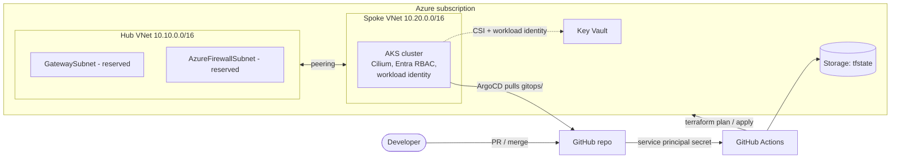

# Secure AKS GitOps Platform

A small, reproducible Azure platform: **Terraform** builds a hub-and-spoke network and an **AKS** cluster
(Entra ID RBAC, workload identity, Key Vault CSI), **GitHub Actions** deploys it using a service principal
client secret stored in GitHub Actions secrets, and **ArgoCD** (app-of-apps) keeps everything inside the cluster
in sync with this repo.

> Status: work in progress, built as a learning project. See [Roadmap](#roadmap) and [Known gaps](#known-gaps).

## What this demonstrates

- Infrastructure as code with remote state in Azure Storage, accessed via Entra ID (no storage keys in CI)
- CI/CD with a service principal secret stored in GitHub Actions secrets: plan on PR, apply on merge, manual destroy
- Hub-and-spoke networking, NSGs, private DNS, optional private endpoint for Key Vault
- AKS with Azure CNI Overlay + Cilium, Entra ID RBAC, workload identity, Key Vault CSI driver
- GitOps with ArgoCD app-of-apps, Prometheus/Grafana, and Kyverno guardrails
- Cost discipline: budget alerts, manual stop/start, teardown workflow

## Architecture



## Repository layout

```
.
├── bootstrap/            one-time: tfstate storage, Entra admin group, budget alert (also contains legacy OIDC setup)
├── terraform/
│   ├── modules/          network, keyvault, aks, workload-identity
│   └── envs/dev/         wires the modules together and installs ArgoCD via Helm
├── gitops/
│   ├── apps/             ArgoCD Applications (picked up by the root app-of-apps)
│   ├── workloads/        manifests for the sample apps
│   ├── policies/         Kyverno ClusterPolicies (Audit mode)
│   └── optional/         Key Vault demo, enabled on demand
├── .github/workflows/    terraform (plan/apply), destroy, aks-power (stop/start)
├── scripts/              helpers for GitHub variables and GitOps values
└── docs/                 runbook, cost notes, architecture decision records
```

## Getting started

**Prerequisites:** Azure subscription (Owner), permission to create app registrations and groups in Entra ID,
`az`, `terraform` >= 1.6, `gh`, `kubectl`. The repository must be **public** (or you must add repo credentials to
ArgoCD) because ArgoCD pulls from GitHub.

1. **Create the repo on GitHub and push this code** (ArgoCD syncs from `main`).
2. **Bootstrap once, locally:**
   ```bash
   az login
   cd bootstrap
   cp terraform.tfvars.example terraform.tfvars   # set subscription_id and your e-mail
   terraform init && terraform apply
   cd ..
   ```
   The bootstrap state stays local (it contains storage keys) and is git-ignored. Keep a private backup.
3. **Configure GitHub Actions credentials and variables.** Add these repository secrets in
   **Settings -> Secrets and variables -> Actions -> Secrets**:
   - `AZURE_CLIENT_ID` — client/application ID for your Terraform service principal
   - `AZURE_CLIENT_SECRET` — that service principal's client secret
   - `AZURE_TENANT_ID` — its Entra tenant ID
   - `AZURE_SUBSCRIPTION_ID` — the target subscription ID

   Do not paste the client secret into the terminal command or commit it to the repository. Add the
   non-secret Terraform state and AKS identifiers as repository variables:
   ```bash
   gh auth login
   scripts/set-github-vars.sh PSamardzhiev/aks-gitops-platform ps01   # ps01 = your unique suffix
   ```
   The service principal needs permissions to manage the platform resources, create required role assignments,
   and access the Terraform state container. The bootstrap's previous OIDC application is not used by these
   workflows.
4. **Create a `dev` environment** in the repo settings (optionally add yourself as a required reviewer for apply).
5. **Deploy:** open a pull request (the pipeline runs checks and a plan), then merge to apply.
   Or run the first apply locally - see [docs/runbook.md](docs/runbook.md).
6. **Look around:** get credentials, port-forward ArgoCD and Grafana ([runbook](docs/runbook.md)).

## Cost control

AKS control plane is on the free tier, but the nodes are not. Budget alerts are created by `bootstrap/`
(they warn, they do not stop spending). The `aks-power` workflow provides manual stop/start only; automatic stopping is disabled. Use
**Actions -> terraform-destroy** when you are done for a while. Details and rough numbers: [docs/cost.md](docs/cost.md).

## Design decisions

| ADR | Decision |
|---|---|
| [0001](docs/adr/0001-github-oidc-instead-of-secrets.md) | Original OIDC decision (superseded by GitHub Actions secrets) |
| [0002](docs/adr/0002-azure-cni-overlay-with-cilium.md) | Azure CNI Overlay with Cilium |
| [0003](docs/adr/0003-hub-spoke-without-firewall.md) | Hub-and-spoke network without Azure Firewall (for now) |
| [0004](docs/adr/0004-argocd-bootstrap-via-terraform.md) | ArgoCD bootstrapped by Terraform, then GitOps takes over |

## Known gaps

Honest list of what this does *not* do yet:

- The CI identity has Contributor + User Access Administrator on the whole subscription (fine for a personal lab, too broad for a shared one).
- AKS local accounts are enabled so Terraform can install ArgoCD; the API server is public.
- Plans are not saved and re-applied; apply runs a fresh plan after the optional approval gate.
- Checkov runs in soft-fail mode until findings are triaged.
- Prometheus has no persistent storage; Grafana uses the chart's default admin password (ClusterIP only, change on first login).
- No ingress or TLS yet; apps are reached with `kubectl port-forward`.

## Roadmap

- [x] Remote state, OIDC, network, AKS, ArgoCD, observability, policy, pipeline (this repo)
- [ ] Python tooling: Azure SDK report of untagged/idle resources, with pytest, run in CI
- [ ] Disable AKS local accounts; private cluster behind a self-hosted runner or VPN
- [ ] Site-to-site VPN to a home lab (deployed only for demos)
- [ ] Ingress-nginx + cert-manager; Azure Firewall egress control (demo only)
